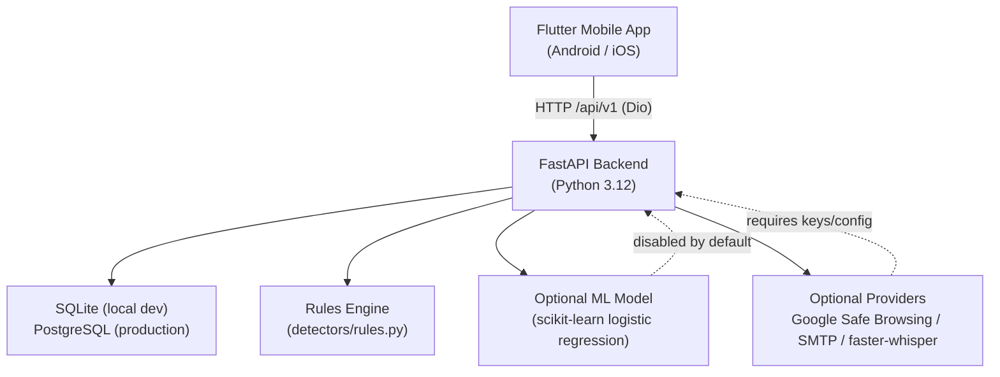

# 🛡️ Scan Shield — Complete Project Analysis

## Overview

**Scan Shield** is an AI-powered, privacy-conscious, multi-channel **fraud detection system**. Users manually submit SMS, email, URLs, voice transcripts, or call detail records for analysis. The app returns a 0–100 risk score with a `Safe / Suspicious / High Risk` label, evidence explanations, history, alerts, feedback, and privacy controls. There is **no automatic inbox/call monitoring**.

> [!IMPORTANT]
> This is a **development candidate**. Rules-based detection works without any API keys. The trained ML model is disabled by default and only validated on SMS spam — not multi-channel fraud.

---

## 🏗️ Architecture



### Key Design Decisions
- **One service + one database** — No Redis, no background queues, no LLM required
- **Rules-first detection** — Works out of the box without any provider keys
- **Separation of concerns** — Rules, scoring, ML inference, and explanations are fully decoupled modules
- **No covert monitoring** — URLs are never fetched; no automatic audio retention; no inbox access
- **Privacy by design** — Opaque tokens, hashed passwords, cascade deletion, input bounds middleware

---

## 📁 Repository Structure (Monorepo)

| Directory | Purpose |
|---|---|
| [`backend/`](file:///c:/Users/vaibh/Documents/AI-Application/AI-Fraud-Dectation-APP/backend) | FastAPI API, SQLAlchemy models, Alembic migrations, detection engine, tests |
| [`mobile/`](file:///c:/Users/vaibh/Documents/AI-Application/AI-Fraud-Dectation-APP/mobile) | Flutter app (Android/iOS/Web), Riverpod state, GoRouter navigation |
| [`ml/`](file:///c:/Users/vaibh/Documents/AI-Application/AI-Fraud-Dectation-APP/ml) | Training scripts, data provenance, evaluation artifacts |
| [`docs/`](file:///c:/Users/vaibh/Documents/AI-Application/AI-Fraud-Dectation-APP/docs) | 32 documentation files covering all aspects |
| [`infrastructure/`](file:///c:/Users/vaibh/Documents/AI-Application/AI-Fraud-Dectation-APP/infrastructure) | Docker/container definitions |
| [`scripts/`](file:///c:/Users/vaibh/Documents/AI-Application/AI-Fraud-Dectation-APP/scripts) | Admin, smoke tests, benchmark, branding, dataset prep |
| [`assets/`](file:///c:/Users/vaibh/Documents/AI-Application/AI-Fraud-Dectation-APP/assets) | SVG/PNG branding assets |
| [`.codex/`](file:///c:/Users/vaibh/Documents/AI-Application/AI-Fraud-Dectation-APP/.codex) | Engineering playbooks: agents, rules, skills, workflows, checklists |
| [`.github/workflows/`](file:///c:/Users/vaibh/Documents/AI-Application/AI-Fraud-Dectation-APP/.github) | CI pipeline |

---

## 🔙 Backend — FastAPI (`backend/`)

### Tech Stack
| Component | Technology |
|---|---|
| Framework | FastAPI `>=0.115` |
| Server | Uvicorn |
| ORM | SQLAlchemy 2.0 |
| Migrations | Alembic |
| Validation | Pydantic v2 + `pydantic-settings` |
| Auth | Argon2 hashed tokens (opaque access/refresh), rotate + revoke |
| Database (local) | SQLite |
| Database (prod) | PostgreSQL via `psycopg[binary]` |
| ML | scikit-learn 1.6.1, joblib, numpy, scipy |
| Speech (optional) | `faster-whisper` (local CPU, not bundled) |
| HTTP client | httpx |

### API Routes (`/api/v1`)
- **`auth`** — Register, login, token refresh, logout, revocation
- **`users`** — Profile, account deletion, privacy/data export
- **`scans`** — Multi-channel scan submission (SMS, email, URL, voice, call details), history, alerts, feedback
- **`reports`** — Admin report review, duplicate detection

### Backend Source Files
| File | Responsibility |
|---|---|
| [`main.py`](file:///c:/Users/vaibh/Documents/AI-Application/AI-Fraud-Dectation-APP/backend/app/main.py) | App factory, CORS, middleware, lifespan, health/ready endpoints |
| [`models.py`](file:///c:/Users/vaibh/Documents/AI-Application/AI-Fraud-Dectation-APP/backend/app/models.py) | SQLAlchemy ORM models |
| [`schemas.py`](file:///c:/Users/vaibh/Documents/AI-Application/AI-Fraud-Dectation-APP/backend/app/schemas.py) | Pydantic request/response schemas |
| [`security.py`](file:///c:/Users/vaibh/Documents/AI-Application/AI-Fraud-Dectation-APP/backend/app/security.py) | Token hashing, auth dependencies |
| [`middleware.py`](file:///c:/Users/vaibh/Documents/AI-Application/AI-Fraud-Dectation-APP/backend/app/middleware.py) | Input size bounds, rate limiting |
| [`scoring.py`](file:///c:/Users/vaibh/Documents/AI-Application/AI-Fraud-Dectation-APP/backend/app/scoring.py) | 0–100 risk score combination |
| [`explanations.py`](file:///c:/Users/vaibh/Documents/AI-Application/AI-Fraud-Dectation-APP/backend/app/explanations.py) | Evidence explanation templates |
| [`detectors/rules.py`](file:///c:/Users/vaibh/Documents/AI-Application/AI-Fraud-Dectation-APP/backend/app/detectors/rules.py) | Rule-based contextual fraud detection |
| [`ml/inference.py`](file:///c:/Users/vaibh/Documents/AI-Application/AI-Fraud-Dectation-APP/backend/app/ml/inference.py) | Optional ML inference (versioned, hash-verified joblib) |
| [`services/detection.py`](file:///c:/Users/vaibh/Documents/AI-Application/AI-Fraud-Dectation-APP/backend/app/services/detection.py) | Detection orchestrator |
| [`services/mail.py`](file:///c:/Users/vaibh/Documents/AI-Application/AI-Fraud-Dectation-APP/backend/app/services/mail.py) | Email delivery (SMTP) |
| [`services/providers.py`](file:///c:/Users/vaibh/Documents/AI-Application/AI-Fraud-Dectation-APP/backend/app/services/providers.py) | External reputation provider (Google Safe Browsing) |
| [`services/storage.py`](file:///c:/Users/vaibh/Documents/AI-Application/AI-Fraud-Dectation-APP/backend/app/services/storage.py) | Temporary audio file handling |

### Backend Tests (`backend/tests/`)
- `test_api.py` — Authentication, scans, history, feedback, reports, alerts, users
- `test_detection.py` — Scoring boundaries, safe messages, URL/email/audio edge cases
- `test_hardening.py` — Rate limits, body limits, malformed inputs, provider failures
- `test_migrations_ml.py` — Alembic upgrade/downgrade, model integrity checks

**Result: 51 tests passed (as of 2026-10-10)**

---

## 📱 Flutter Mobile App (`mobile/`)

### Tech Stack
| Component | Technology |
|---|---|
| Framework | Flutter (Dart SDK `^3.11.1`) |
| State Management | Riverpod `^3.0.0` |
| Navigation | GoRouter `^17.0.0` |
| HTTP | Dio `^5.9.0` (with serialized token refresh) |
| Secure Storage | `flutter_secure_storage ^10.0.0` |
| Local Cache | `sqflite ^2.4.0` (Android/iOS SQLite) |
| File Picking | `file_picker ^10.0.0` |
| Audio Recording | `record ^6.1.0` |
| SVG Assets | `flutter_svg ^2.2.0` |
| Sharing | `share_plus ^12.0.0` |
| Preferences | `shared_preferences ^2.5.0` |

### App Structure (`mobile/lib/`)
```
lib/
├── main.dart                    ← Entry point, ProviderScope setup
├── app/app.dart                 ← Root widget, GoRouter config, theme
├── core/
│   ├── api.dart                 ← Dio API client, token refresh
│   └── providers.dart           ← Riverpod providers
├── shared/widgets.dart          ← Shared components (Brand, EmptyState, RiskChip…)
└── features/
    ├── onboarding/              ← First-use flow
    ├── authentication/          ← Login/register/reset
    ├── dashboard/               ← Home screen with summary
    ├── scan/                    ← Scan submission (all channels)
    ├── results/                 ← Risk score display, evidence
    ├── history/                 ← Scan history
    ├── reports/                 ← User report management
    ├── account/                 ← Profile, help
```

### Platforms
- **Android** — Primary target; debug APK built (`artifacts/android/scan-shield-debug.apk`)
- **iOS** — Code exists; requires macOS + signing for build
- **Web** — Scaffolded; Chrome test runner was blocked

---

## 🤖 ML Pipeline (`ml/`)

### Detection Workflow
```
Input text
  → NFKC Unicode + whitespace normalization
  → Remove duplicates / variable-number / URL templates
  → Discard conflicting template labels
  → Stratified 70/15/15 train/val/test split (deterministic)
  → TF-IDF unigrams + bigrams
  → Class-balanced Logistic Regression
  → Held-out evaluation
```

### Key Constraints
- Model is **disabled by default** (`MODEL_PATH` env var must be set)
- Only applicable to **SMS channel** currently
- Trained on UCI SMS Spam dataset (CC BY 4.0) — **spam ≠ fraud**
- Inference **never trains**; no user feedback auto-trains the model
- Artifacts are hash-verified (SHA-256 manifest); corrupted artifacts fail startup

### Training Commands
```powershell
python scripts/prepare_uci_dataset.py
python ml/training/train.py --dataset ml/data/uci_sms.csv --provenance ml/data/uci_provenance.json --output ml/artifacts/baseline.joblib
```

---

## 🔐 Security Model

| Concern | Mitigation |
|---|---|
| Authentication | Argon2-hashed opaque tokens, access/refresh rotation, revocation |
| Input validation | Pydantic bounded schemas, middleware request size limits |
| URL safety | URLs never fetched; optional Google Safe Browsing only |
| Audio | PCM WAV only, max 10 MB/180s; validated before decode; deleted after processing |
| Data isolation | All records are user-owned; admin role for reports only |
| Logging | No raw scan content logged; secrets redacted at startup |
| Email attachments | Never executed |
| Rate limiting | Per-route database-backed rate limits in middleware |

---

## ✅ Feature Status Summary

| Feature | Status | Notes |
|---|---|---|
| Onboarding | ✅ Tested | Emulator navigation passed |
| Auth (login/register/delete) | ✅ Tested | Real-backend emulator journey passed |
| Home / Dashboard | 🟡 Implemented | Widget/device test pending |
| SMS Scan | ✅ Tested | Rules + real-backend Android journey passed |
| Email Scan | ✅ Tested | Metadata/import; device pending |
| URL Scan | ✅ Tested | Rules; live reputation key not tested |
| Voice Scan | 🔴 Blocked | No local speech model bundled |
| Call Details | 🟡 Implemented | Text engine reused |
| Scan Results | ✅ Tested | Risk label/icon/contrast emulator passed |
| History | ✅ Tested | API tests passed; device cache pending |
| Alerts | ✅ Tested | In-app only; no OS push notifications |
| Feedback | ✅ Tested | API + mobile UI done; device dialog pending |
| Reports/Admin | ✅ Tested | API done; operational review pending |
| Profile/Privacy | ✅ Tested | Export/delete API; device export pending |
| ML Model Training | ✅ Tested | SMS spam baseline only |
| Push Notifications | ⏸️ Deferred | In-app alerts only |
| Anonymous Mode | ⏸️ Deferred | Sign-in required |
| Store Release / iOS | 🔴 Blocked | No signing, macOS required |
| Production Hosting | 🔲 Not Started | Docker definitions exist |
| Representative Fraud Data | 🔄 In Progress | UCI SMS spam is insufficient |

---

## 🗺️ Roadmap (Priority Order)

1. **Physical-device testing** — recording, secure storage, share/export, accessibility
2. **Production infrastructure** — PostgreSQL, TLS, SMTP, backup/restore, hosting
3. **Representative fraud datasets** — validate FP/FN, calibrate model before enabling
4. **Speech inference** — provision approved local model, test consented audio
5. **Device notifications** — local push with permission/duplicate controls
6. **Reputation adapter** — approved commercial provider with quota monitoring
7. **Future (roadmap)** — Regional NLP, deepfake detection, live calls, browser extension, banking partners, federated learning

---

## ⚠️ Known Limitations

- English rules only — regional language coverage not validated
- Risk thresholds are **heuristics**, not calibrated fraud probabilities
- No real-time analysis, sender authentication, SPF/DKIM, or phone intelligence
- URLs never visited (no certificate/DNS/redirect analysis)
- No speech model bundled; voice scan blocked
- No OS push notifications (in-app alert records only)
- Production hosting not set up; Docker only
- iOS/physical Android not validated; macOS required for iOS build

---

## 🛠️ Development Setup

```powershell
# Backend
cd backend
..\.venv\Scripts\python.exe -m alembic upgrade head
uvicorn app.main:app --reload

# Mobile (Android emulator with API at 10.0.2.2:8000)
cd mobile
flutter run

# Tests
.\.venv\Scripts\python.exe -m pytest -q     # 51 backend tests
flutter analyze                              # no issues
flutter test                                 # unit tests
flutter test -d <device> integration_test    # integration
```

---

## 📊 CI/CD

- GitHub Actions workflow: [`.github/workflows/ci.yml`](file:///c:/Users/vaibh/Documents/AI-Application/AI-Fraud-Dectation-APP/.github/workflows/ci.yml)
- Linting: `ruff` (backend, ml, scripts)
- Security audit: `pip-audit` (no known vulnerabilities as of last run)
- Docker: `docker-compose.yml` (PostgreSQL + API container; not locally executed)
